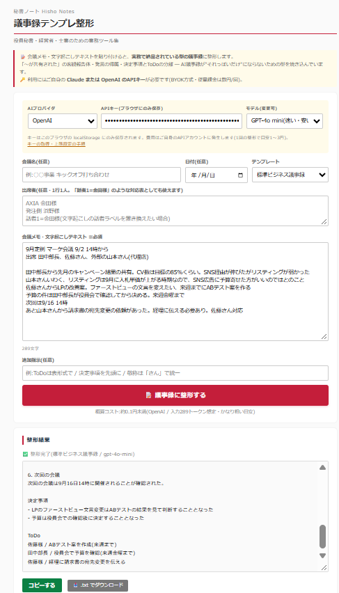

# 秘書ノート / 議事録テンプレ整形

> 役員秘書・経営者・士業のための業務ツール集 — その第5作。

会議メモ・文字起こしテキストを貼り付けると、**実務で納品されている型の議事録**に整形するツールです。「〜が共有された」の客観報告体、発言の帰属、決定事項とToDoの分離 ─ AI議事録が"それっぽいだけ"にならないための型を、プロンプトに焼き込んであります。

**BYOK方式**(Claude または OpenAI の自分のAPIキーを使用)。サーバ不要のシングルHTMLです。

---

## デモ

---

## ⚠️ 最初に:このツールはテキストを外部に送信します

秘書ノートの他のツールと異なり、本ツールは**貼り付けたテキストを、選択したAI事業者(Anthropic / OpenAI)のAPIに送信**して整形します。

- どちらのAPIも、送信データは**デフォルトでAIの学習に使われない**方針です(2026年時点の各社規約)
- とはいえ議事録は機密度の高い文書です。**固有名詞のマスキング**(「A社」「X円」等への置換)と、**社内規程の確認**を推奨します
- APIキー・入力内容がこのツールの作者に送られることはありません(作者のサーバ自体が存在しません)

---

## できること

- **会議メモ・文字起こし → 納品品質の議事録に整形**
- **テンプレート3種**
  - 標準ビジネス議事録(番号付き議題・決定事項・ToDo表の納品型)
  - 社内定例(軽量版:決定事項・ToDo・共有事項)
  - 商談・営業メモ(先方の状況・反応・ネクストアクション中心)
- **文体ルールを強制** ─ 客観報告体(「〜が共有された」)/ 発言帰属(「○○様より〜との回答があった」)/ 創作禁止・曖昧箇所は【要確認】
- **話者ラベルの置き換え** ─ 出席者欄に「話者1=金田様」と書けば、文字起こしの話者ラベルを実名に正規化
- **Claude / OpenAI 両対応** ─ 持っている方のキーで使える。モデル名も変更可能
- **概算コスト表示** ─ 送信前に文字数とおおよその費用(目安1〜3円/回)を表示
- 結果は編集可能・コピー・.txtダウンロード

---

## 「ChatGPTに直接頼むのと何が違うの?」

正直に言うと、**1回だけなら大差ありません**。ChatGPTやClaudeのチャット画面に「この型で議事録にして」と長いプロンプトを毎回貼れば、同じ出力は得られます。技術的な魔法は何もありません。

差が出るのは、**毎週それをやるとき**です。

| | チャットに直接頼む | このツール |
|---|---|---|
| 型の指定 | 毎回プロンプトを書く・探す。書かないと"それっぽいだけ"の要約になる | 型が埋まっている。貼って押すだけ |
| 出力のブレ | 頼み方で毎回変わる。人によっても変わる | 誰がやっても同じ型で出る |
| 手順 | チャットを開く → プロンプトを探す → 貼る → 指示する | 貼る → 押す |
| 属人化 | 「あの人のプロンプトが上手い」が起きる | 型がツール側にあるので誰でも同じ |

つまりこのツールの正体は、**プロンプトをツールに固定したもの**です。それ以上でも以下でもありません。

### では、何がこのツールの価値か

**埋め込まれている「型」そのもの**です。

- 客観報告体(「〜が共有された」「〜との認識を合わせた」)
- 発言の帰属(「○○様より〜との回答があった」)
- 事実・発言・決定を混ぜない
- 決定事項とToDo(担当付き)を末尾に分離
- 原文にないことは書かない。曖昧な箇所は【要確認】

この文体ルールは、**実際に議事録作成代行で納品している議事録**から抽出したものです。「AIに詳しい人」ではなく「議事録を納品している人」の側から出てくる型で、汎用の議事録プロンプトとの差はここに出ます。

AIに議事録を書かせると"それっぽいだけ"になるのは、モデルの性能不足ではなく、**型と文体ルールが指定されていないから**です。

---

## 必要なもの:APIキー(どちらか一方)

**ChatGPT Plus / Claude Pro の契約とAPIは別物です。**APIは従量課金で、クレジットカード登録と最低$5(約750円)のクレジット購入が必要です。1回の整形は数円程度なので、$5で数百回分が目安です。

### Claude(Anthropic)の場合

1. https://console.anthropic.com/ にアカウント登録
2. **Billing** でクレジットを購入(最低$5)
3. **Spend limits** で月額上限を設定(推奨)
4. **API Keys** でキーを作成(`sk-ant-...`)

### OpenAIの場合

1. https://platform.openai.com/ にアカウント登録
2. **Billing** で支払い方法を登録し、クレジットを購入(最低$5)
3. **Limits** で月額上限を設定(推奨:$5)← 意図しない課金の防止
4. **API keys** でキーを作成(`sk-...`)

> 💡 月額上限の設定は、秘書ノート第1作(会食お店ピックアップ)のQuota設定と同じ思想の「事故防止策」です。必ず設定することをおすすめします。

---

## 使い方

1. `index.html` をブラウザで開く(ダブルクリックでOK・サーバ不要)
2. 初回のみ:確認モーダルで3点にチェック(外部送信・費用・機密の扱い)
3. プロバイダ(Claude / OpenAI)を選び、APIキーを貼り付け(ブラウザに保存されます)
4. 会議メモ・文字起こしを貼り付け(会議名・日付・出席者は任意)
5. テンプレートを選んで **「📝 議事録に整形する」**
6. 結果を確認・必要なら編集 → コピー or .txtダウンロード

### 精度を上げるコツ

- **出席者欄を埋める**と、発言の帰属(「○○様より」)が正確になります
- 文字起こしに「話者1:」等のラベルがある場合は「話者1=○○様」と対応表を書く
- 長い会議(2万字超)は議題ごとに分割して実行すると精度が安定します
- **AIの出力は必ず人間の目で確認**してください。日付・金額・固有名詞は特に

---

## プライバシー・データの扱い

- APIキー・モデル設定は、お使いの**ブラウザ(localStorage)にのみ保存**されます
- 貼り付けたテキストは、**整形の瞬間にのみ**選択したAI事業者へ送信されます(保存はされません)
- 整形結果はブラウザ内にのみ表示され、どこにも保存されません(必要ならご自身でダウンロード)
- 共有PCではAPIキーの保存にご注意ください(使用後にキー欄を消すことを推奨)

---

## カスタマイズしたい時

シングルHTMLなので、`index.html` をテキストエディタで開いて該当箇所を書き換えるだけです。

| やりたいこと | 書き換え場所 |
|---|---|
| 議事録の型・文体ルールを自社流に変える | `STYLE_RULES` と `TEMPLATES` 定数 |
| テンプレートを追加する | `TEMPLATES` にキーを追加 + `<select id="template">` に選択肢追加 |
| 既定モデルを変える | `PROVIDERS` の `defaultModel` |
| コスト概算の単価を最新にする | `PROVIDERS` の `priceIn` / `priceOut`(1Mトークンあたりのドル) |

---

## 免責事項

- 本ツールは **無償で提供されるサンプル実装** です
- 貼り付けたテキストは、選択したAI事業者のAPIに送信されます(上記「プライバシー」参照)
- API利用料はご自身のAPIアカウントに発生します。**月額上限の設定を強く推奨**します
- AIの出力には誤りが含まれる可能性があります。内容の正確性は保証されません。必ず確認のうえご利用ください
- AI事業者のAPI仕様変更・料金改定により動作や費用感が変わる可能性があります
- 本ツール利用に起因する一切の損害(API費用・出力内容の誤りを含む)について、作者は責任を負いません
- 商用利用を含めMITライセンスに準拠します

---

## ライセンス

MIT License — 詳細は [LICENSE](../LICENSE) を参照。

---

## 「秘書ノート」シリーズについて

業務で「これ毎週やってる…自動化できるはず」と思った作業をツール化して順次公開していくシリーズです。

- 第1作 [会食お店ピックアップ](../restaurant/) — 店を決める
- 第2作 [訪問先カルテ](../visit-prep/) — 相手を調べる
- 第3作 [会議パック](../meeting-pack/) — 段取りを配る
- 第4作 [VIPプロファイル管理](../vip-profile/) — 人の情報を組織に残す ★旗艦
- 第5作 **議事録テンプレ整形**(本ツール) — 会議の記録を仕上げる
- 番外編 [スポ少サポートツール](../spo-tool/)

---

## 作者・お問い合わせ

**合同会社AuroraNce / 代表 西脇 あゆみ**(元総合商社役員秘書)

このツールのデフォルトテンプレートは、**実際に議事録作成代行で納品している議事録の型**をもとにしています。

テキストの整形はこのツールで無料でどうぞ。**音声データの文字起こしから議事録納品まで丸ごと任せたい方は、議事録作成代行を承っています。**録音を送っていただくだけで、この型の議事録が届く形です。

- GitHub Issues: 動作不具合の報告はこちらへ
- メール: [info@aurorance.biz](mailto:info@aurorance.biz)
- ウェブサイト: [aurorance.biz](https://aurorance.biz/)
