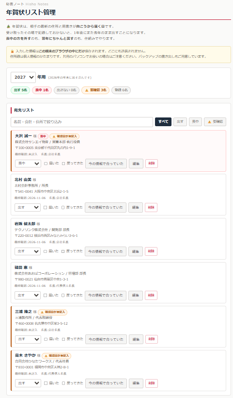

# 秘書ノート / 年賀状リスト管理

> 役員秘書・経営者・士業のための業務ツール集 — その第7作。

**年賀状は、相手の最新の住所と肩書きが、向こうから届く日です。**

ところが、受け取ったその場で記録しないので、1年後にまた去年のまま出すことになります。「○○部長」が、もう本部長になっているのに。

このツールは、年賀状を**年に一度の住所録の棚卸し**として扱います。そして、**喪中の方を外すこと**と、**翌年にちゃんと戻すこと**を仕組みでやります。

**API不要・登録不要・課金なし。** ブラウザで開くだけで動くシングルHTMLです。

## デモ



## できること

### 情報が古くなるのを防ぐ

- **最終確認日**を1件ごとに持ちます。「この住所と肩書きで間違いない」と分かった日です
- 2年以上たつと **⚠️ 要確認** が付きます。絞り込みでまとめて見られます
- **役職の履歴**が残ります。役職を書き換えると、前の役職が年つきで残ります
  ```
  役職の履歴:2025年 営業本部 部長 → いま
  ```
- **「届いた」にチェックを入れると、最終確認日が自動で今日になります。** 年賀状が届いた＝その住所で間違いなかった、ということなので
- **「今の情報で合っていた」**ボタン1つでも確認日を更新できます(名刺をいただいた、異動のご挨拶が届いた、など)
- **「戻ってきた」**の記録もできます。宛先不明で返ってきた方は、次回に印が付きます

### 喪中(このツールの安全装置)

**喪中は「年」とセットで持ちます。** これが設計の中心です。

- 書き出すとき、**喪中の方は必ず外れます**。しかも外した方の**お名前を出して**確認します
  ```
  2027年用のCSVを書き出します。

    出す:42名
    喪中のため外す:3名
      山田太郎様・鈴木花子様・佐藤次郎様

  ⚠️ 出す方のうち5名は、2年以上確認していません。
  ```
- **翌年になると、喪中は自動で解けます。** そのうえで
  ```
  🕊️ 昨年(2027年)は喪中だった方が3名います。
     今年は喪中が明けているので、「出す」に戻しています。
  ```
  と確認を出します

防ぐ事故は2つあります。**喪中の方に出してしまうこと**と、**喪中が明けたのに翌年も外したままにしてしまうこと**です。後者は、チェックボックス1つで作ると必ず起きます。

### 名簿と書き出し

- 氏名・敬称・会社・部署・役職・郵便番号・住所・**差出人の名義**・メモ
- **いまの住所録を、Excelから見出しごとコピーして貼り付けるだけで取り込めます**(タブ区切り・カンマ区切りの両方)。同じお名前と会社の方は飛ばします
- **年賀状ソフト用のCSV**を書き出せます(筆まめ・筆ぐるめ・はがきデザインキットなどに取り込めます)。Excelで開けるようBOM付きです
- **「出す人」の一覧をコピー**できます。差出人の名義ごとに分かれ、**住所は入りません**。社長や代表に見てもらう確認用です
- バックアップ(JSON)の書き出し・読み込み

## 使い方

1. `index.html` をブラウザで開きます(ダウンロードしてダブルクリックでも動きます)
2. 「いまの住所録を取り込む」に、Excelの住所録を見出しごと貼り付けます
3. 一覧で、今年の予定(出す / 出さない / 喪中)を選びます
4. 「年賀状ソフト用のCSVを書き出す」で書き出し、お使いのソフトに取り込みます
5. お正月に届いた年賀状を見ながら、**「届いた」にチェック**を入れていきます。肩書きが変わっていたら、その場で直します
6. 翌年は、上の年を切り替えるだけです。喪中は自動で解け、確認が出ます

### 取り込みで読み取る見出し

| 項目 | 見出しの書き方 |
|---|---|
| 氏名 | 氏名 / 名前 / お名前 / 宛名 / name |
| 敬称 | 敬称 |
| 会社名 | 会社 / 会社名 / 勤務先 / 団体名 |
| 部署 | 部署 / 所属 |
| 役職 | 役職 / 肩書 / 肩書き |
| 郵便番号 | 郵便番号 / 〒 / zip / 郵便 |
| 住所1 | 住所 / 住所1 |
| 住所2 | 住所2 / 建物 / 建物名 / ビル名 |
| 差出人の名義 | 差出人 / 名義 / 差出人名義 |
| メモ | メモ / 備考 |

## やらないこと

作り込みすぎないよう、次のことは入れていません。

- **宛名の印刷レイアウト** — 既存の年賀状ソフトのほうが圧倒的に強いので、CSVを渡すところまでにしています
- **郵便番号から住所の自動入力** — 外部のAPIを使わない方針のためです
- 年賀状の文面づくり・デザイン

## データの扱い

- 入力した内容は、**お使いの端末のブラウザ(localStorage)の中にだけ**保存されます。どこにも送信されません
- 保存キー: `hishoNenga`
- 住所録は個人情報のかたまりです。**共用のパソコンでのご利用はおすすめしません**
- 書き出したCSV・JSONには氏名と住所がそのまま入ります。**共有フォルダやデスクトップに置いたままにしないでください**
- ブラウザのデータを消すと、入力内容も消えます。買い替えの前にバックアップを書き出してください

## 注意

このツールは無料でお使いいただけます。ただし、**ご利用によって生じた問題について、弊社は責任を負いかねます。** 宛先は必ず最後にご自身の目でご確認ください。

不具合・ご要望は [GitHub Issues](https://github.com/aurorance-1015/hisho-notes/issues) へどうぞ。

## ライセンス

MIT License — 詳細は [LICENSE](../LICENSE) を参照。

## 作者

**合同会社AuroraNce / 西脇 あゆみ**(元総合商社役員秘書)

秘書業務BPO・業務自動化・事務代行を承っています。「もう少しうちの業務に合わせて作り変えてほしい」「運用ごと任せたい」といったご相談もお気軽にどうぞ。

- メール: [info@aurorance.biz](mailto:info@aurorance.biz)
- ウェブサイト: [aurorance.biz](https://aurorance.biz/)
