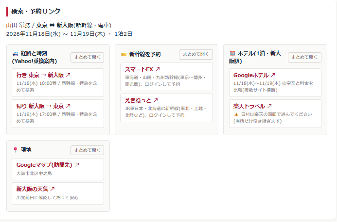

# 秘書ノート / 出張リンクパック

> 役員秘書・経営者・士業のための業務ツール集 — その第6作。

出張の手配で、同じ「行き先と日付」を、乗換サイト・新幹線の予約・ホテル検索…と何度も打ち直していませんか。

1回の入力で、**乗換・予約・ホテル・地図のリンク**と、役員に送る**行程表**、**出張準備のチェックリスト**をまとめて作ります。

**API不要・登録不要・課金なし。** ブラウザで開くだけで動くシングルHTMLです。

---

## デモ

---

## できること

- **新幹線・電車 / 飛行機を切り替えて入力**
- **1回の入力から、検索・予約のリンクをまとめて作成**
  - 🚄 経路と時刻(Yahoo!乗換案内):行き・帰り。**新幹線・特急を含め、出発時刻/到着時刻の指定まで**入った状態で開く
  - ✈️ 便を探す(Googleフライト):泊まりなら往復、日帰りなら片道2本で、日付入り
  - 🎫 予約サイトの入口:スマートEX・えきねっと / JAL・ANA
  - 🏨 ホテル:Googleホテル(日付入りで料金比較)・楽天トラベル(駅周辺)
  - 📍 現地:訪問先の地図・天気
  - 「まとめて開く」で、行きと帰りを一度にタブで開ける
- **行程表をつくる** ─ 予約した便・時刻・ホテル名を入れると、役員や同行者に送る文面ができる(メール用の丁寧版 / LINE・チャット用の短い版)
- **出張準備チェックリスト(自分で作れる)** ─ たたき台の11項目から始めて、**自由に追加・削除**できる。「田中社長は新幹線は窓側E席」「○○社は受付で入館証が必要」のような、**自分だけが知っている段取り**を書き足していける
  - 「テキストでコピー」でリストを書き出し、**後任や同僚に渡せる**。受け取った側は、追加欄に貼り付けるだけで一括で取り込める
  - 「チェックを外す」で項目は残したまま次の出張に使い回せる
- **日帰りは日付から自動判定** ─ 行きと帰りが同じ日なら、ホテルの検索を省く
- **履歴** ─ 最近の出張を10件まで保存。よく行く出張先を呼び出して日付だけ変えられる

---

## ⚠️ 予約する前に

**このツールはリンクを作るだけで、予約や支払いはしません。**

リンク先の各サイトは、仕様が予告なく変わることがあります。その場合、日付などの条件がうまく引き継がれないことがあります。

**予約の前に、リンク先の画面で「日付・時刻・人数」を必ず確認してください。** 日付違いの予約は取消料がかかる場合があります。

---

## 使い方

1. `index.html` をブラウザで開く(ダブルクリックでOK・サーバ不要)
2. 「新幹線・電車」か「飛行機」を選ぶ
3. 出発地・行き先・行きと帰りの日時を入れる(出張する人・泊まるエリア・訪問先は任意)
4. **「🧳 出張リンクを作成」**
5. リンクから経路を調べて、予約サイトで予約
6. 予約が決まったら、便名・時刻・ホテル名を「行程表をつくる」に入れる → コピーして役員に送る
7. チェックリストで準備の漏れを確認(リストは出張リンクを作らなくても、いつでも編集できます)

### 入力のコツ

- 駅名は「東京」「新大阪」のように、**「駅」を付けずに**入れるのが確実です(付けても自動で外します)
- 飛行機は都市名(東京・福岡・札幌など)か空港名(羽田・伊丹など)で
- 「この時刻までに到着」を選ぶと、「○時の会議に間に合う便」を探せます

---

## 各サイトへのリンクについて(作者が確認したこと)

リンクを作るだけのツールでも、**リンク先に条件が正しく入らなければ、かえって事故のもと**になります。公開前に、すべてのリンクを実物のブラウザで開いて、画面の入力欄まで確認しました(2026年9月時点)。

その過程で見つかった落とし穴と、対応です。

| サイト | 落とし穴 | 対応 |
|---|---|---|
| Yahoo!乗換案内 | 「新幹線」「特急」の指定を省くと**在来線だけの8時間のルート**が出る | 新幹線・特急(飛行機モードでは飛行機も)を必ず指定 |
| Googleホテル | 一般的な日付の指定方法だと**無視され、別の日付が入る** | 「10月13日から10月14日」の形で渡す |
| Googleフライト | 帰りの日付がないと**勝手に往復にされ、帰りの日付を適当に入れられる**(運賃が間違う) | 泊まりは往復、日帰りは片道2本に分ける |
| 楽天トラベル | ネットでよく見るリンクの書き方は古く、**別の地域の宿が並ぶ** | 楽天の公式フォームと同じ書き方に。**日付はURLで渡せない**ため、楽天の画面で選ぶ |
| 駅すぱあと | 外部のリンクで駅や日時を渡せない | 対象外にしました |

サイト側の仕様が変わってリンクが動かなくなった場合は、[GitHub Issues](https://github.com/aurorance-1015/hisho-notes/issues) で教えていただけると助かります。

---

## プライバシー・データの扱い

- 本ツールは **完全にブラウザ内で動作**します(サーバ通信ゼロ・APIキー不要)
- 入力した出張先・日程・行程と、チェックリストの項目・チェック状態は、お使いの**ブラウザ(localStorage)にのみ保存**されます
- リンクをクリックしたときに初めて、各サイトへ検索条件(駅名・日付など)が渡ります
- 共有PCでは、出張の予定が次の人に見えてしまいます。使い終わったら履歴を削除するか、プライベートモードでご利用ください

---

## カスタマイズしたい時

シングルHTMLなので、`index.html` をテキストエディタで開いて該当箇所を書き換えるだけです。

| やりたいこと | 書き換え場所 |
|---|---|
| チェックリストの「たたき台」の項目を自社流に変える | `DEFAULT_CHECKLIST` の中身(画面上でも自由に編集できます) |
| 行程表の文面(あいさつ・見出し)を変える | `buildItinerary()` 関数 |
| 使うサイトを足す・外す | `buildGroups()` 関数と、リンクを作る `L` の中身 |
| 履歴の保存件数(初期10件) | `h.slice(0, 10)` の数値 |

---

## 免責事項

- 本ツールは **無償で提供されるサンプル実装** です
- 本ツールは各サイトへのリンクを作るだけで、予約・支払い・空席や料金の確認は行いません
- リンク先サイトの仕様変更により、条件が正しく引き継がれない場合があります。予約前に必ずリンク先で内容をご確認ください
- 本ツール利用に起因する一切の損害(予約の誤り・取消料などを含む)について、作者は責任を負いません
- 商用利用を含めMITライセンスに準拠します

---

## ライセンス

MIT License — 詳細は [LICENSE](../LICENSE) を参照。

---

## 「秘書ノート」シリーズについて

業務で「これ毎週やってる…自動化できるはず」と思った作業をツール化して順次公開していくシリーズです。

- 第1作 [会食お店ピックアップ](../restaurant/) — 店を決める
- 第2作 [訪問先カルテ](../visit-prep/) — 相手を調べる
- 第3作 [会議パック](../meeting-pack/) — 段取りを配る
- 第4作 [VIPプロファイル管理](../vip-profile/) — 人の情報を組織に残す ★旗艦
- 第5作 [議事録テンプレ整形](../minutes/) — 会議の記録を仕上げる
- 第6作 **出張リンクパック**(本ツール) — 出張の手配をまとめる
- 番外編 [スポ少サポートツール](../spo-tool/)

---

## 作者・お問い合わせ

**合同会社AuroraNce / 代表 西脇 あゆみ**(元総合商社役員秘書)

チェックリストのたたき台は、役員秘書として出張手配をしていたときに頭の中で確認していたことを書き出したものです。ただ、本当に大事な段取りは「この役員はこう」「この訪問先はこう」という個別のものなので、自分で書き足せる形にしました。書き足したリストは、そのまま引き継ぎ資料になります。

リンクを作るところまではこのツールで無料でどうぞ。**出張の手配そのもの(便の選定・予約・行程表の作成・当日の変更対応)を任せたい方は、秘書代行で承っています。**

- GitHub Issues: 動作不具合・リンク切れの報告はこちらへ
- メール: [info@aurorance.biz](mailto:info@aurorance.biz)
- ウェブサイト: [aurorance.biz](https://aurorance.biz/)
